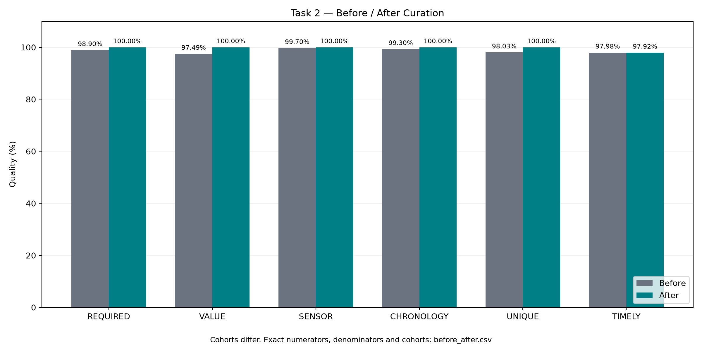

# Bổ sung Task 2 — Chất lượng sau xử lý

- Before run: `2ecccd58-0c78-4b4f-97cc-2f417b8c0217`
- After run: `abb46f3d-0d82-45ba-8cc1-f0c933935816`
- Hash contract và input manifest của hai báo cáo khớp nhau.

| Chỉ số | Before | After | After đạt ngưỡng |
| --- | --- | --- | --- |
| Q_REQUIRED | 9850/9960 = 98.90% | 9610/9610 = 100.00% | Đạt |
| Q_VALUE | 9710/9960 = 97.49% | 9610/9610 = 100.00% | Đạt |
| Q_SENSOR | 9930/9960 = 99.70% | 9610/9610 = 100.00% | Đạt |
| Q_CHRONOLOGY | 9890/9960 = 99.30% | 9610/9610 = 100.00% | Đạt |
| Q_UNIQUE | 9960/10160 = 98.03% | 9610/9610 = 100.00% | Đạt |
| Q_TIMELY | 9690/9890 = 97.98% | 9410/9610 = 97.92% | Đạt |
| Q_REFERENCE_COVERAGE | Chưa đo | 100/100 = 100.00% | Đạt |
| Q_REFERENCE_AGREEMENT | Chưa đo | 95/100 = 95.00% | Đạt |

## Giải thích kết quả

Before đo trên winners trước lọc tính hợp lệ; riêng uniqueness dùng tập key-eligible. After đo trên curated. Timeliness ở cả hai lần chỉ đo trên các dòng có chronology hợp lệ. Vì cohort thay đổi, không diễn giải đây là phép đo trên cùng một tập dòng.

Timeliness giảm nhẹ từ 9690/9890 xuống 9410/9610. Cả hai cohort có 200 dòng late; sau xử lý, mẫu số giảm nhưng các dòng late còn hợp lệ vẫn được giữ lại.

Reference coverage đạt 100/100. Agreement đạt 95/100 trong sai số 0,05 °C, đúng ngưỡng 95%. Năm ID không đạt agreement không bị xóa hoặc sửa theo reference để cải thiện kết quả.

Các defect trước xử lý có thể chồng lặp, không cộng chúng để suy ra số dòng quarantine.

Các kết quả này là quan sát chất lượng; không thay thế gate G01–G09 hoặc approval phát hành.

Chi tiết tử số, mẫu số, cohort và ngưỡng: `before_after.csv`.
